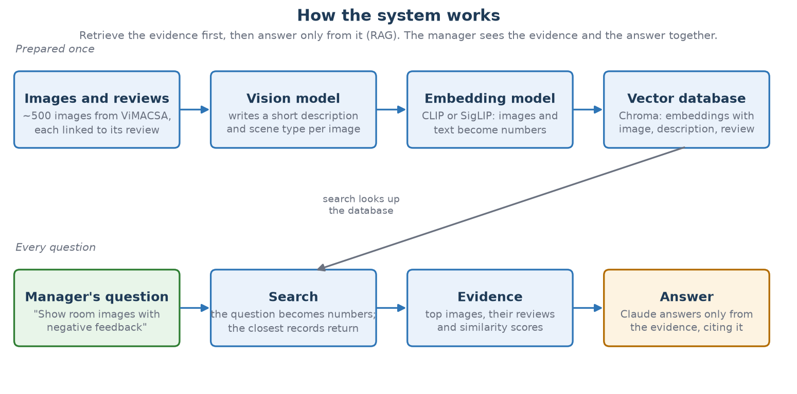

# Multimodal Hotel Intelligence Assistant: the brief, with what we did

> **How to read this document.** The brief's own text is unchanged, in normal type. Under each point, a box says **what we did**, how, and the result, as of 24 November 2026. Numbers such as D12 are decisions in the decision log (document 03), CR-04 a change in the change log (10), F01 and Q09 test questions, R-03 a risk (06).
>
> **The project in brief.** A manager types a question in plain English and gets the matching hotel photos, the reviews behind them and, on request, a short answer written only from that evidence.
>
> – **Data:** 501 photos and 267 reviews from ViMACSA (research use only); Vietnamese reviews translated by Claude and kept beside the original.
>
> – **How:** Claude described each photo; SigLIP and CLIP turned photos and text into embeddings on this Mac; Chroma stores them; the reviews' own labels supply sentiment; Claude Sonnet 5.5 answers from the shown evidence, citing every point.
>
> – **Result:** P@5 0.81 on 25 test questions and 0.72 on 10 unseen ones; 100% label accuracy; answers 95.7% backed by their evidence; business UAT 12 of 12; $9.24 of a $10 budget.
>
> – **Code and documents:** github.com/tezla-timemachine/hotel-intelligence-assistant (public; the dataset is not published).
>
> – **Tools:** Python 3.12; Anthropic SDK (Claude); Transformers with CLIP and SigLIP; Chroma; Streamlit; pandas.

## Project Title

Multimodal Hotel Intelligence Assistant

> **What we did:** built it under this name, in its own folder and a public GitHub repository: `hotel-intelligence-assistant`.

## Business Scenario

A hotel group has customer reviews together with hotel images.

> **What we did:** used the ViMACSA dataset: 4,876 Vietnamese hotel reviews, each with up to 7 guest photos, labelled by topic (room, food, facilities, public area, service, location) and sentiment.

Management wants to search and understand both the written feedback and the related images in one system.

> **What we did:** one database holds each photo, its generated description and its review, so one question searches all three (Chroma, six collections, D10).

For example: "Show me room images related to negative reviews." "Find hotel facilities associated with positive feedback." "Show images related to complaints about public areas." "What are customers saying about the rooms shown in these images?"

> **What we did:** all four are test questions (Q09–Q16, with the brief's Step 5 examples) and buttons in the app. All are read correctly: "Show me room images related to negative reviews" becomes **topic Room, sentiment Negative, looking for "room"**. P@5 on these brief questions: 0.82.

The goal is to build a multimodal system that understands both images and text.

> **What we did:** images are understood twice: by Claude (a written description of each photo) and by SigLIP and CLIP (embeddings that place photos and text in one space). Text is understood through translation, embeddings and the reviews' labels.

## Dataset

Use the ViMACSA multimodal hotel dataset. Dataset Repository: github.com/hoangquy18/Multimodal-Aspect-Category-Sentiment-Analysis; Google Drive link.

> **What we did:** checked the GitHub page first (contents, language, labels, terms, size), then downloaded `ViMACSA.zip` (3.5 GB) from the Drive link with your yes. Its SHA-256 is recorded in `data/raw/MANIFEST.md`, and the zip was deleted after selection to free disk space (D2). **Terms: research use only**, so the photos and reviews are never published.

The complete dataset contains thousands of documents and around 14,000 images.

> **What we did:** measured it: 4,876 reviews; 18,311 images in the zip, of which **9,058 belong to a review** (the rest are linked to nothing). 74% of sentiment labels are positive, 10% negative (fact sheet).

You do not need to process the complete dataset. For this project, take approximately: 500 images; a small selected set of review documents.

> **What we did:** **501 images and their 267 reviews**, selected by `scripts/select_dataset.py` (seed 7): whole reviews with all their photos, topic quotas, and **half from reviews with a negative point** (130 of 267), because the brief's questions are mostly about complaints (D3).

Keep the project manageable and focus on understanding the multimodal pipeline rather than processing every available record.

> **What we did:** the full pipeline runs end to end on the 501: translate, describe, embed, store, search, answer, evaluate. Embedding and building the database take 80 seconds on this Mac.

## Main Product Goal

Build a system where a user can search hotel information using natural language.

> **What we did:** a search box in a Streamlit app (http://localhost:8507). Plain English in; the app shows how it understood the question (topic, sentiment, what it looked for).

The application should understand both: Text; Images.

> **What we did:** text through the reviews' translations and labels; images through SigLIP embeddings (the search) and Claude's descriptions (shown with each photo).

The system should return relevant images, related reviews, and a short answer based on the retrieved information.

> **What we did:** the top 6 photos with match scores and their reviews (English, with the Vietnamese original on request), and, on a button, a short answer from Claude Sonnet 5.5 citing E1–E6. The answer costs about 1 cent, so it runs only when asked.

## Step 1: Prepare the Dataset

Select around 500 images and a manageable number of associated reviews.

> **What we did:** 501 images, 267 reviews (D3). The first quotas gave 585 images, so they were trimmed (CR-02).

Keep the connection between every image and its related review.

> **What we did:** `data/selected/images.csv` links every image to its review ID; a check found 0 orphans and 0 missing files.

Review what information is actually available before creating the final dataset.

> **What we did:** the **dataset fact sheet** (`docs/dataset.md`): files, fields, labels, language, counts and problems found. **Key finding:** of 101 photos from reviews complaining about the room, only **52 show a room**. The product had to join what photos show with what reviews say (R-03).

Do not create fields that are not present in the source unless you clearly mark them as generated information.

> **What we did:** every field is tagged **from the source**, **generated** or **calculated**. The English translation is tagged `generated: claude-opus-5-5`; descriptions are tagged with the model and prompt; the app labels them too, and always shows the Vietnamese original.

## Step 2: Image Understanding

Use a Vision Language Model such as ChatGPT Vision or Moondream.

> **What we did:** Claude Opus 5.5, tried on 10 photos first and checked side by side, then all 501 ($4.10, D8). **In hindsight, a cheaper model would have done:** Sonnet at about half the cost (D16, the case study's main lesson).

Generate a short description for each selected image. For example: Room interior; Swimming pool; Restaurant food; Lobby; Hotel facility; Public area.

> **What we did:** a fixed answer form for every photo: a **scene type** (room, bathroom, pool, restaurant, food, lobby, exterior, view, facility, public area, other), a one-to-two-sentence **description**, **key objects** and **visible issues** (stains, wear). Most common: room 111, pool 80, view 74, food 70. People are only ever "a guest" or "a person".

Store the image description together with the original image and related review.

> **What we did:** in the same record (`data/selected/images.csv` and every database record), tagged as generated.

## Step 3: Multimodal Embeddings

Create embeddings for the images and text.

> **What we did:** for every photo, every description and every English review, with two models: 2,538 embeddings in all, on this Mac, free.

You can use a multimodal embedding model such as CLIP or SigLIP.

> **What we did:** **both**: CLIP (OpenAI, ViT-B/32) and SigLIP (Google, base), each about 0.6–0.8 GB, saved in the project and loaded with no internet access (D10).

The purpose is to place images and text in a similar semantic space.

> **What we did:** both models put a sentence and a photo in the same space, so their similarity can be measured directly. The scores differ in scale (a good SigLIP match is about 0.1, CLIP about 0.3), so the app shows each as a share of the best match (R-14).

This allows a text query to retrieve relevant images.

> **What we did:** checked first with simple questions: "a hotel swimming pool", "a hotel bathroom", "breakfast buffet food" put the right scenes on top with both models.

## Step 4: Vector Database

Store the multimodal embeddings in a vector database.

> **What we did:** **Chroma**, on this Mac: six collections (images, descriptions and reviews, for each model), 20 MB, cosine similarity (`scripts/build_index.py`).

Each record should remain connected to: Image; Image description; Related review; Relevant metadata.

> **What we did:** every record carries the image file, review ID, scene type, the image's topics, the review's labels, and a true/false flag for each label (such as `Room_Negative`) so search can filter on them.

This will allow semantic search across the dataset.

> **What we did:** yes: searches take 0.1–0.2 seconds in the app.

## Step 5: Natural Language Search

Create a simple search interface.

> **What we did:** `scripts/search.py`, then the app (Step 10). Every search is logged with its question, method, results and time.

Examples: "Show room images associated with negative feedback." "Find images related to good hotel facilities." "Show public areas mentioned in negative reviews." "Find images connected with positive comments about food."

> **What we did:** **rules read the question (D12):** topic words ("room", "breakfast", "pool") and sentiment words ("negative", "complaints", "good") become filters on the **reviews' own labels**; what's left ("room images") is matched against the **photos**. Photos can't show how a guest felt, so sentiment always comes from the review. The rules missed 3 of 25 test questions at first ("bathrooms", "dislike", "spa treatment rooms"); after the fix (CR-04) they read all 35 test and fresh questions correctly.

The system should return the most relevant results.

> **What we did:** the top 6 by similarity, with scores. Without the labels, only 47% of results came from reviews with the asked-for sentiment; with them, 100%.

## Step 6: Multimodal RAG

Add a multimodal RAG layer.

> **What we did:** `scripts/answer.py`: Claude receives the question and the 6 retrieved items as evidence E1–E6, each **the photo itself** plus its review and labels.

The system should first retrieve relevant images and reviews.

> **What we did:** the same search as Step 5; the answer never sees anything else.

Then a Vision Language Model or LLM should generate an answer using only the retrieved information.

> **What we did:** the prompt (a1) allows only the cited items: every point must cite its evidence, the answer must say when a photo doesn't show what its review says, and must say "not enough evidence" when it can't answer. **Claude Sonnet 5.5** since D16 (Opus 5.5 before): 95.7% of points backed by their evidence on the fresh questions; about $0.013 and 5 seconds per answer.

Example: "What are the main complaints about the rooms shown in these images?" The system should retrieve the relevant room images and reviews and generate a short answer.

> **What we did:** tested (Q09, Q12, Q13, and in UAT). Answers list the complaints (rooms not as booked, "unlivable", no air conditioning) with their sources, and point out that **most photos don't show the complaint**: dirt or a broken lock can't be seen. Asked for a gym that isn't there, the answer says the evidence can't answer.

## Step 7: Evaluate the Search

Create around 20 to 30 test queries.

> **What we did:** **25 test questions** (visual, the brief's examples, detail, and edge cases with nothing to find), plus **10 fresh questions kept back** and run once at the end. All 35 were written before any test was run (evaluation plan 07).

For each query, manually identify what type of result should be relevant.

> **What we did:** a written rule per question ("the photo shows a swimming pool") and a relevance guide. To avoid about 700 judgements by hand, Claude **Sonnet** judged each photo seeing **only the photo and the rule** (a different model from the one that wrote the descriptions), checked against the dataset's own image labels: 87.7% agreement, the gap being definitions (D14, D15).

Measure: Precision at K; Retrieval accuracy; Response time; Incorrect retrievals.

> **What we did:** for the chosen approach: **P@5 0.81, P@10 0.82**, first result right 77% (90% on the fresh questions), **0.06 s** per search; 36 incorrect results in the top 5 across 25 questions, each listed with the judge's reason.

Check whether the returned images actually match the user's request.

> **What we did:** 1,225 photo judgements in all, each on the photo itself, never its description or score.

## Step 8: Compare Different Approaches

Compare at least two approaches. For example: Text search using generated captions; Multimodal embedding search. You can also compare CLIP and SigLIP if time allows.

> **What we did:** six runs on the same 25 questions: photo search with SigLIP and with CLIP, caption search with each model's text encoder, keyword search on the descriptions, and photo search without the labels.

Create a simple comparison table.

> **What we did:**
>
> | Approach | Retrieval quality (P@5) | Response time | Notes |
> |---|---|---|---|
> | Caption search, SigLIP / CLIP | 0.53 / 0.47 | 0.06 / 0.03 s | Text encoders built for text-to-image, not text-to-text; SigLIP cuts long descriptions |
> | Keyword search on captions | 0.63 | 0.02 s | Finds named details ("stains"); fails when words differ |
> | **Multimodal search, SigLIP** | **0.81** | 0.06 s | **Chosen.** Best P@10 (0.82) |
> | Multimodal search, CLIP | 0.80 | 0.03 s | Close; better on rooms and "dirty" |
> | Multimodal search without labels | 0.54 | 0.05 s | Only 47% from reviews with the right sentiment |

Explain which approach works better and why.

> **What we did:** **multimodal search on the photo itself, with SigLIP and the reviews' labels.** Matching the question directly to the photo beats matching it to a written description of the photo (a second, lossy step), and sentiment has to come from the labels because photos can't show it (D17).

## Step 9: Failure Analysis

Review the searches that perform badly.

> **What we did:** all 36 wrong top-5 results of the chosen approach, plus the 14 unsupported answer points and the 3 question misreadings (`evals/results/20261124_failure_analysis.md`).

Check whether: The image was misunderstood; The review was unrelated to the image; The embedding returned visually similar but irrelevant images; The query was too broad; The system misunderstood the relationship between text and image.

> **What we did:** every failure tagged with one of the five:
>
> – **visually similar but irrelevant** (11): balconies for "bedrooms with a balcony", city streets for "sea views";
>
> – **text and image relationship** (5): "dirty or worn rooms" scored 0, because embeddings don't see dirt;
>
> – **review unrelated to the image** (5): complaints about staff with a photo of a pool;
>
> – **query too broad or nothing to find** (10): gym and spa;
>
> – **image misunderstood** (5): one sitting-area photo ranked first for every room question.

Document a few important failure cases and possible improvements.

> **What we did:** five, with fixes: **hybrid search** (photos plus keyword on visible issues) for condition questions; searching each part of a **two-part question**; a **warning** when a photo's own label differs from the question (built into the app); answering **broad questions** from the labels first; agreeing the borderline "is a sitting area a room?" rule with users.

## Step 10: User Interface

Create a simple application with: Search box; Retrieved image gallery; Related review text; Similarity score; Short AI generated answer.

> **What we did:** all five, in Streamlit (`app/app.py`), plus "photos like this one" (search by image), the original Vietnamese and the description on request, and label badges in red and green. **Business UAT 12 of 12 passed** (D18); UAT found searches taking 2 s, fixed to 0.1–0.2 s (DF-10).

The main experience should be simple: User asks a question; System searches images and text; System returns the relevant evidence; System generates an answer.

> **What we did:** that order on the screen: the question, how it was understood, the answer button, then the evidence E1–E6 that the answer cites.

## Final Deliverables

> **What we did:**
>
> | Deliverable | Where |
> |---|---|
> | Selected multimodal dataset: ~500 images, selected reviews | `data/selected/` (on this computer; research use only) |
> | Image understanding pipeline | `scripts/describe_images.py`, prompt d1 |
> | Multimodal embeddings; vector database | `scripts/embeddings.py`, `scripts/build_index.py`, `data/chroma/` |
> | Natural language search; multimodal RAG | `scripts/search.py`, `scripts/answer.py` |
> | Evaluation queries; retrieval evaluation | `evals/test_questions.csv`, `evals/fresh_questions.csv`, `evals/results/` |
> | Approach comparison; failure analysis | `evals/results/20261124_search_evaluation.md`, `…_failure_analysis.md` |
> | Simple user interface | `app/app.py` |
> | GitHub repository | github.com/tezla-timemachine/hotel-intelligence-assistant |
> | Also: BAU documents 01–10, fact sheet, privacy, limitations, experiment log, README, CHANGELOG, HANDOVER | `docs/`, `evals/`, the repository root |

## Main Learning Outcome

By the end of the project, you should understand how text and images can be used together inside one AI product. You should understand: Vision Language Models; Multimodal embeddings; Text to image retrieval; Image to text understanding; Semantic visual search; Multimodal RAG.

> **What we did:**
>
> – **Vision language models:** Claude described 501 photos in a fixed form.
>
> – **Multimodal embeddings:** CLIP and SigLIP put photos and text in one space.
>
> – **Text to image retrieval:** a question finds photos (P@5 0.81).
>
> – **Image to text understanding:** descriptions, and "photos like this one" leading to their reviews.
>
> – **Semantic visual search:** meaning, not keywords: "breakfast buffet" finds buffets with no caption needed.
>
> – **Multimodal RAG:** answers from photos and reviews together, every point cited.
>
> **And the product lessons:** join what images show with what text says; take sentiment from labels, not pictures; keep a fresh test set; and **choose the cheapest model that fits**.
