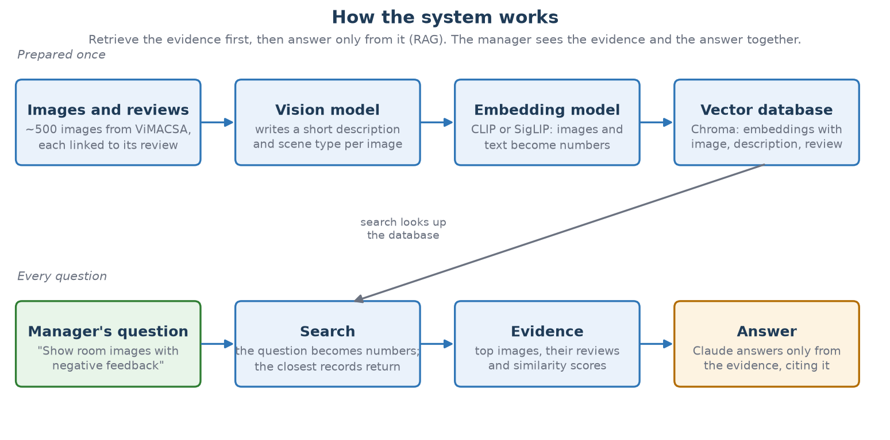

# AI Architecture and Decision Log: Multimodal Hotel Intelligence Assistant

> **Status:** v1.0, approved by the Product Owner, 23 Nov 2026 (D7). Sections 1–2 describe the design before it's built; they're updated as each part is built and tested. Section 3 records every decision, with the reason and who made it.

---

## 1. System architecture

**Two paths:**
- **Prepared once:** select the data, translate the reviews, describe each image, embed everything, store it in the vector database.
- **Every question:** embed the question, find the closest records (and apply the source's labels where asked), show the evidence, then have Claude answer from that evidence only.

**What leaves this computer:** only calls to Claude: the review texts for translation (approved, D4), the images for description (Decision C), and each question's retrieved evidence for the answer (Decision F). Embeddings, search and the database all run locally.

---

## 2. Components

| Component | What it does | Tool | Requirements |
|---|---|---|---|
| Selection | Picks ~500 images and their reviews by a repeatable rule; extracts only those images | Python, `scripts/select_dataset.py` | FR-01 |
| Translation | Vietnamese reviews into English, tagged as generated | Claude Opus 5.5, `scripts/translate_reviews.py` (done) | FR-02, FR-03 |
| Image description | A short description and a scene type for each image, in a fixed answer form, plus key objects and visible issues | Claude Opus 5.5, prompt d1, `scripts/describe_images.py` (D8) | FR-04 |
| Embedding models | Turn images and text into vectors in one shared space | CLIP ViT-B/32 and SigLIP base, run locally from `models/` (D10) | FR-05, FR-06 |
| Vector database | Stores the vectors with each record's links and metadata; finds the nearest | Chroma 1.5.9, locally in `data/chroma/` (D10) | FR-07 |
| Search | Reads the question by rules (D12), filters on the review labels, ranks by image, caption or keyword similarity, returns the top 6 with scores; also search by image | `scripts/search.py` | FR-08 to FR-10, FR-15 |
| Answer (RAG) | Claude reads the retrieved photos and reviews and answers only from them, citing each | Claude **Sonnet** 5.5, prompt a1, `scripts/answer.py` (D16; Opus 5.5 until 24 Nov, D13) | FR-11, FR-12 |
| App | Search box, gallery, reviews, scores, answer | Streamlit (Decision H) | FR-13 |
| Logs | Every model call and every search | CSV files in `data/results/` | FR-14, FR-15 |
| Evaluation | Test questions, relevance judgements, P@K, comparison, failures | `evals/`, Python | FR-16 to FR-18 |

### 2.1 One record in the database (built in Phase 3)

| Field | Example | Tag |
|---|---|---|
| `image_file` | image_3188_0.png | Source |
| `review_id` | train-0412 | Source order, our numbering |
| `review_vi` | Phòng mùi thuốc lá nồng nặc… | Source |
| `review_en` | The room smelled strongly of cigarettes… | **Generated** (Claude Opus 5.5) |
| `labels` | Room#Negative; Public_area#Neutral | Source |
| `image_topics` | Public_area | Source |
| `description`, `scene_type` | "Hotel corridor with carpet and doors"; public area | **Generated** (Decision C) |
| Image, description and review vectors | 512 numbers (CLIP) or 768 (SigLIP) | Calculated |
| Label flags | `Room_Negative`: true, … one per topic and sentiment, plus `any_Negative` | Calculated from the source labels, for filtering |

**Six collections** in `data/chroma/` (`scripts/build_index.py`): images, descriptions and reviews, each for CLIP and SigLIP. Image and description records are one per image; review records are one per review, listing its images. Cosine similarity throughout.

### 2.2 How the AI quality requirements are met

| Requirement | How |
|---|---|
| Relevant results at the top | Measured with Precision at K against Tez's judgements; three approaches compared |
| Grounded answers | The answer prompt allows only the retrieved items, with an ID for each; every claim must cite one. Checked by hand on every test answer |
| Honest gaps | The prompt requires "not enough evidence" when the items don't answer the question |
| Generated fields tagged | Every generated field has a source tag in the data and a label in the app |
| Nothing about individuals | Description prompt forbids describing people; checked on a sample |
| Calls traceable | Every call logs the model asked for **and** the model used (the Week 5 lesson, DF-11), with a check that the field is filled |

---

## 3. Decision log

| ID | Date | Decision | Why | Decided by |
|---|---|---|---|---|
| D1 | 23 Nov 2026 | Week 7 is built as planned in `docs/week7-plan.md`: seven phases, one at a time, with a sign-off at each. It lives in its own folder, `Week 7 Project`, with the **same BAU documents as Weeks 1 and 5** (01–10), plus a fact sheet, experiment log, privacy and limitations notes, README, CHANGELOG, HANDOVER and the annotated brief | The same way of working as Weeks 4 and 5. Tez asked for all the BAU documents, as in the other projects | Product Owner (Tez), "Approve, start Phase 1" |
| D2 | 23 Nov 2026 | **Decision A, the dataset:** ViMACSA.zip (3.5 GB) downloaded from the Google Drive link in the authors' GitHub README. Only the 5 label files and the selected images are kept; the zip is deleted, with its SHA-256 recorded in `data/raw/MANIFEST.md`. **Images and reviews are never published** | The Mac had 7.9 GB free. The dataset's terms say research use only, with no open licence | Product Owner (Tez), "Yes, download" |
| D3 | 23 Nov 2026 | **Selection:** 501 images and their 267 reviews (`scripts/select_dataset.py`, seed 7). Whole reviews with all their images; image-topic quotas, half from reviews with a negative point; at most 4 images per review | Keeps every image linked to its review. Negatives are only 20% of the dataset, but the brief's questions are mostly about complaints. The first quotas gave 585 images, so they were trimmed to land near 500 | Product Owner (Tez), "Approve, close Phase 1", 23 Nov 2026 |
| D4 | 23 Nov 2026 | **Decision B, language:** the 267 reviews translated into English by Claude Opus 5.5 (effort low), tagged `generated: claude-opus-5-5`; the Vietnamese original kept. $0.75 | Managers ask and read in English; CLIP and SigLIP work best in English. Spot-check of 9: meaning and tone kept | Product Owner (Tez), "Yes, translate" |
| D5 | 23 Nov 2026 | **Lessons from the Week 4 and 5 feedback are built in:** the product story and its value in money are written in Phase 1 (01); every document is checked against the others before each push; scope is explicit (01, section 8); search is tuned on one set of test questions and checked on a fresh set it has never seen | Mentor feedback on Week 4: product story unclear, business value missing, no validation on new data, documents inconsistent, scope unclear | Product Owner (Tez), plan approval |
| D6 | 23 Nov 2026 | **Every model call logs the model asked for and the model used**, and a check fails if either is empty | In Week 5 a missing model name made monitoring silently ignore new calls (DF-11) | Product Owner (Tez), "Approve, close Phase 1", 23 Nov 2026 |
| D7 | 23 Nov 2026 | **Phase 1 closed.** Documents approved as v1.0: fact sheet, 01 brief, 02 requirements, 03 architecture, 04 plan, 05 schedule; risk register (06) v0.1 and change log (10) started | All of Step 1 done; figures checked across every document | Product Owner (Tez), "Approve, close Phase 1", 23 Nov 2026 |

| D8 | 23 Nov 2026 | **Decision C, image descriptions:** Claude Opus 5.5, effort low, prompt d1, fixed answer form (scene type from 11, description, key objects, visible issues). Tried on 10 first, then all 501: $4.10, 0 failures. Tagged `generated: claude-opus-5-5, prompt d1` | Best quality for caption search and the app; trial checked side by side. Moondream was free but unreliable with fixed forms in Week 5 | Product Owner (Tez), "Yes, try 10 first" and "Yes, describe all" |
| D9 | 23 Nov 2026 | **Phase 2 closed.** All 501 images described and checked (D8); descriptions merged into `data/selected/images.csv`. Phase 3 software approved for install: about 2.7 GB, with usage statistics off | Step 2 done; disk space allows it (6.4 GB free) | Product Owner (Tez), "Yes, close and install", 23 Nov 2026 |
| D10 | 23 Nov 2026 | **Decisions D and E, installed:** CLIP (`openai/clip-vit-base-patch32`, 151M parameters) and SigLIP (`google/siglip-base-patch16-224`, 203M, Apache 2.0), saved once into `models/` and loaded from there with no network; Chroma 1.5.9 as the vector database. Week 7 environment: Python 3.12, PyTorch 2.15, Transformers 5.24 (`requirements.txt`). Usage statistics off (Streamlit, Hugging Face, Chroma). Actual size **3.1 GB** (environment 1.7 GB, models 1.36 GB) against a 2.7 GB estimate; CLIP was downloaded twice in two formats, so one copy was kept. Test: both models matched "swimming pool", "bedroom" and "buffet food" to the right photos | Both run on this Mac, free, nothing sent online. Two models are needed for the comparison (Step 8) | Product Owner (Tez), "Yes, close and install" (D9) |
| D11 | 23 Nov 2026 | **Phase 3 closed.** Six Chroma collections built and checked (`scripts/build_index.py`); risks R-13 (texts cut off) and R-14 (score scales) added | Steps 3 and 4 done; counts and links match the selection | Product Owner (Tez), "Yes, start Phase 4", 23 Nov 2026 |
| D12 | 23 Nov 2026 | **Decision I, reading a question: rules.** Word lists turn the question into topics (Room, Food, Facilities, Public area, Service, Location) and a sentiment (Positive, Negative). Only images whose **review carries that label** are searched, and they're ranked by how well the **image** matches what's left of the question. The app shows how the question was understood. Claude reading the question is the fallback if the rules miss too much | Images can't show sentiment, so sentiment comes from the review's own label. Free, instant and transparent | Product Owner (Tez), "Approve both" |
| D13 | 23 Nov 2026 | **Decision F, answers: Claude Opus 5.5 with the images** (effort low). It gets the top 6 photos and their reviews, and must answer only from them, citing each point, or say there isn't enough evidence. About $0.02 a question | A truly multimodal answer, as the brief asks; it can see what the photos show, not only their descriptions | Product Owner (Tez), "Approve both" |
| D14 | 23 Nov 2026 | **Evaluation plan (07) approved, with Decision G option B:** 25 test questions and 10 fresh ones kept back; relevance judged by Claude Sonnet 5.5 against written rules, seeing only the photo and the rule; the judge checked against the dataset's image labels (at least 90% agreement). Pass marks as in 07, section 6. **Phase 4 closed** | Pass marks set before testing (D5); a different model judges than the one that wrote the descriptions; Tez preferred not to judge about 700 photos by hand | Product Owner (Tez), "Approve, option B", 23 Nov 2026 |
| D15 | 23 Nov 2026 | **Evaluation decisions:** (1) the question-rule fixes (CR-04) adopted; (2) the AI judge accepted at **87.7%** agreement with the image labels, below its 90% mark, recorded as missed: the disagreements are definitions, not judging errors; (3) the first-result mark (85%) **missed at 77%**, accepted and reported: 3 of the 5 misses are one sitting-area photo with no bed, ruled "not a bedroom" under our own strict wording | Results reported as measured, with reasons, as in Week 5 (D17 there) | Product Owner (Tez), "Approve the fixes", 23 Nov 2026 |
| D16 | 24 Nov 2026 | **Answers move from Opus 5.5 to Sonnet 5.5** (CR-05). **Standing rule for model choice:** start with the cheapest model that fits the job, show its price first, test on a small sample, and use a dearer model only with evidence and the Product Owner's yes | On 8 sample questions Sonnet backed 100% of its points against Opus's 78%, at half the cost and 2 s faster (X12). Opus had been chosen by default for translation, descriptions and answers without trying cheaper models; Haiku 5.5 is 40 times cheaper than Opus. Overspend in Week 7 about $3 | Product Owner (Tez), "carry on with the work … stop wasting my money", 24 Nov 2026 |
| D17 | 24 Nov 2026 | **Phase 5 closed.** Product approach: image search with SigLIP and the review labels (P@5 0.81). Grounding on Opus answers 87.8% against a 95% mark, recorded as missed; the Sonnet sample reached 100%, to be confirmed on the fresh questions | Steps 7 and 8 done; results in `evals/results/20261124_search_evaluation.md` | Product Owner (Tez), "carry on with the work … stop wasting my money", 24 Nov 2026 |
| D18 | 24 Nov 2026 | **Business UAT passed: 12 of 12** (Tez, in the app). System and AI tests: 20 pass, 2 partly (grounding, judge check), 1 fail (first result, accepted D15), 1 not run (fresh questions, Phase 7). 11 defects: 6 fixed, 2 accepted, 3 open | The app does what the brief's Step 10 asks; two defects found in UAT were fixed the same day (DF-10 speed, DF-11 wording) | Product Owner (Tez), "all passed", 24 Nov 2026 |
| D19 | 24 Nov 2026 | **Phase 6 closed:** failure analysis, app, privacy note, UAT (D18) and the risk register signed off. Fresh test approved: the chosen approach only (image search, SigLIP, labels), judged by the same judge (Sonnet 5.5) for a fair comparison, answers by Sonnet 5.5; about $0.45 | The fresh questions are the check that the choices weren't tuned too closely to the test questions (D5) | Product Owner (Tez), "Yes, run it", 24 Nov 2026 |
| D20 | 24 Nov 2026 | **Fresh test passed:** P@5 0.72 against 0.81 on the test questions (mark: within 0.10); first result 90%; Sonnet answers 95.7% backed (mark 95%). Grounding mark now met; the 87.8% applied to Opus answers | Results reported as measured (`evals/results/20261124_fresh_test.md`); the weak spots match the failure analysis | Delivery Lead (Claude), from the approved test (D19) |
| D21 | 24 Nov 2026 | **Decision H, GitHub:** public repository https://github.com/tezla-timemachine/hotel-intelligence-assistant: code, prompts, app, documents, questions and summary results. Not published: photos, reviews, translations, descriptions, the database, the models and row-level outputs that quote reviews or describe photos | Mentors can open it, as in Weeks 4 and 5; the dataset is research use only | Product Owner (Tez), "Yes, push", 24 Nov 2026 |
| D22 | 25 Nov 2026 | **View-only mode for demos:** started with `VIEW_ONLY=1`, the app hides the answer button (the only call to Claude). Search, the gallery, labels and "photos like this" work as usual, on this computer | The mentor sees the app on a screen-share without spending API credit; switched off by starting the app normally | Product Owner (Tez), 25 Nov 2026 |

**Open decisions:** none. (answer model), G (test questions and relevance), H (app and GitHub), I (how search uses the labels, Phase 4). See the plan, section 4.

---

## 4. Where humans stay in the loop

| Point | Who | What they do |
|---|---|---|
| Before any data goes to Claude | Product Owner | Approves what's sent, and the cost |
| Relevance judgements | Delivery Lead | Judges each test result relevant or not, on the image itself |
| Every answer in the app | Manager | Sees the evidence next to the answer, and decides what to act on |
| Models, prompts, thresholds | Product Owner | Approves changes through the change control log (10) |

---

## 5. Risks the architecture introduces

| Risk | Why | Protection |
|---|---|---|
| Look-alike but wrong photos | Embeddings match what things look like, not what guests meant | Labels used where the question asks; failure analysis (Step 9) |
| Answers that go beyond the evidence | Language models fill gaps | Answer only from cited items; "not enough evidence"; checked on every test answer |
| Translation drift | A generated translation can lose nuance | Original kept; spot-checks; translation tagged |
| Local model size | CLIP, SigLIP and their software need about 2.5–3 GB | Sizes shown before install; the zip already deleted |
| One online provider | Translation, descriptions and answers use Claude | Logged; search still works without it, answers don't |
