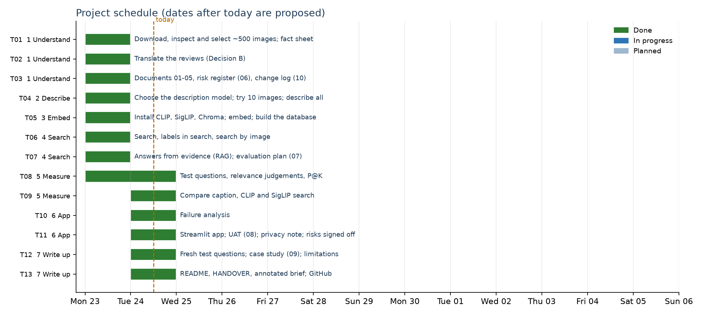

# Project Plan: Multimodal Hotel Intelligence Assistant

> **Status:** v1.0, approved 23 Nov 2026 (D7). Dates after today are a **proposal**. The schedule and Gantt chart (05) are drawn from `scripts/project_schedule.py`, so they always match this plan.

---

## 1. Summary

| | |
|---|---|
| Goal | Search hotel reviews and their photos together in plain English, with answers built only from the evidence (01, 02) |
| Approach | Seven phases, one at a time, each signed off by the Product Owner (D1) |
| Team | Tez: Product Owner and Delivery Lead. Claude: builds and drafts, proposes and waits for a yes |
| Budget | Claude usage under **$10** (02). Spent: **$9.24** (translation $0.75; descriptions $4.10; answers $1.01; relevance judging $2.76; answer checks $0.62) |
| Disk | 6.4 GB free after selection; the image models need about 2.5–3 GB |
| Proposed finish | 1 December 2026 |

## 2. Phases

| Phase | Brief steps | Deliverables | Sign-off |
|---|---|---|---|
| **1. Understand** | 1 | Dataset downloaded and inspected; 501 images and 267 reviews selected; reviews translated; fact sheet; documents 01–05; risk register (06) and change log (10) started | **Done** (D2 to D7) |
| **2. Describe** | 2 | A description and scene type for every image, tagged as generated; description model chosen (Decision C) | **Done** (D8, D9) |
| **3. Embed and store** | 3, 4 | CLIP and SigLIP installed and run; image, description and review embeddings; Chroma database with every link | **Done** (D10, D11) |
| **4. Search and answer** | 5, 6 | Plain-English search with scores; labels used where asked (Decision I); search by image; grounded answers (Decision F); evaluation plan (07) written **before** testing | **Done** (D12 to D14) |
| **5. Measure and compare** | 7, 8 | 20–30 test questions with Tez's judgements; P@5, P@10, retrieval accuracy, time, incorrect retrievals; caption against CLIP against SigLIP | **Done** (D15 to D17) |
| **6. Failures and the app** | 9, 10 | Failure analysis; Streamlit app; UAT workbook (08); privacy note; risk register signed off | **Done** (D18, D19) |
| **7. Write it up** | Deliverables | **Fresh test questions** run once; case study (09); limitations; README, CHANGELOG, HANDOVER; annotated brief; GitHub | **Done** (D20, D21) |

## 3. Gantt chart

## 4. Task schedule

The tasks, dates, dependencies and status are in `hotel-intelligence-05-project-schedule.csv` (13 tasks, T01–T13).

## 5. Milestones

| Milestone | Proposed date | Evidence |
|---|---|---|
| Dataset selected and translated | 23 Nov | **Done:** fact sheet, `data/selected/` |
| Every image described | 24 Nov | Descriptions in the selection files; experiment log |
| Database built | 25 Nov | Chroma folder; record counts match the selection |
| First answered question | 26 Nov | A grounded answer, every claim cited |
| Evaluation results | 27 Nov | P@K tables; comparison table |
| App accepted | 29 Nov | UAT workbook signed |
| Published | 1 Dec | GitHub repository, without the dataset |

## 6. Critical path and dependencies

Descriptions (T04) → embeddings and database (T05) → search (T06) → answers (T07) → evaluation (T08, T09) → failure analysis (T10) → write-up (T12, T13).

- **Caption search needs the descriptions** (T04) before it can be compared (T09).
- **The evaluation plan (07) must be written before testing**, so the pass marks aren't fitted to the results.
- **The fresh test questions** are written in Phase 5 but run only once, in Phase 7.

## 7. Assumptions and constraints

| | |
|---|---|
| Disk | 6.4 GB free. Installs are shown with their size first; anything not needed is removed |
| Language | Reviews are Vietnamese; the English translations are generated (D4) |
| Licence | Research use only: the images and reviews are never published (D2) |
| Hardware | CLIP and SigLIP run on this Mac's processor; about 500 images should take minutes, not hours *(estimate)* |
| Approvals | Every send to Claude, download, install and push needs the Product Owner's yes |
