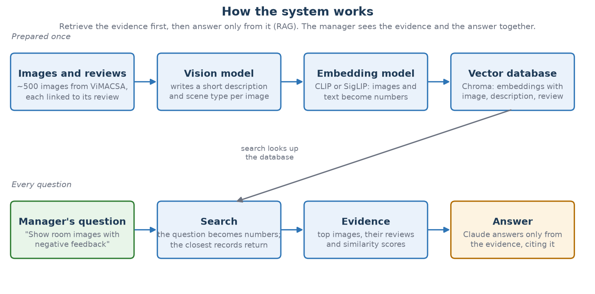
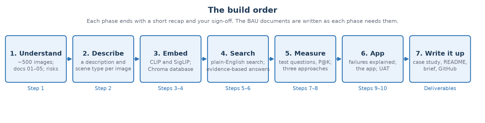

# Project plan: Multimodal Hotel Intelligence Assistant

**What this is:** your guide to the project, in the same style as the casino floor project. It explains what we're building, the order we'll build it in, the decisions you'll make, and, for every point in the brief, what we plan to do. As we go, each line's status changes from Not started to Done, with what we actually did.

**Status key:** Not started · In progress · Done

---

## 1. The project in one page

**The problem.** A hotel group has thousands of guest reviews and the photos that go with them. Today, a manager who wants to know "what are guests unhappy about in our rooms?" has to read reviews one by one, and can't search the photos at all.

**What we're building.** A search assistant where a manager types a question in plain English, for example *"Show room images associated with negative feedback"*, and gets back:
- the **most relevant hotel images**, with a similarity score;
- the **reviews** connected to each image;
- a **short answer**, written by AI **only from what was retrieved**, so every claim can be traced to an image or a review.

**How.** Three kinds of AI work together:
- a **vision language model** writes a short description of each image ("room interior with twin beds");
- a **multimodal embedding model** (CLIP or SigLIP) turns images and text into lists of numbers placed so that similar meanings sit close together. That's what lets a text question find a picture;
- a **language model** reads the retrieved images and reviews and writes the answer. Retrieving first and answering second is called **RAG** (retrieval-augmented generation).

**Scope (Version 1):** about **500 images** and their reviews, not the full 14,000. Search and answers only: no booking, no changes to reviews, no live data.

**Built in from the start, from reviewer feedback on the revenue forecasting project:**
- **The product story and its value in money** are written in Phase 1, not at the end;
- **every document gives the same final position**, checked before each push;
- **the scope stays explicit:** what's in Version 1 and what's future work;
- **a fresh test:** search is tuned on one set of test questions, then checked on a second set it has never seen.

---

## 2. How we'll work

- **One phase at a time.** Each phase ends with a short recap and your sign-off.
- **Decisions:** why it matters, the options and trade-offs, a recommendation, then you decide. Every decision goes in the decision log.
- **Nothing leaves your computer without a yes.** That covers sending images or reviews to Claude, and any upload.
- **Downloads and installs:** I give you the size first. Nothing happens until you say yes.
- **Your keys stay yours.** The Anthropic key is copied file to file from an earlier project, never shown.
- **The same project documents as earlier projects**, numbered 01–10 (section 6).

| Phase | Brief steps | What you'll have at the end |
|---|---|---|
| 1. Understand the data | 1 | The dataset as it really is; ~500 images and their reviews selected; the product story; documents 01–05 |
| 2. Describe the images | 2 | A short description and a scene type for every image, stored with the image and its review |
| 3. Embeddings and database | 3, 4 | Every image and text turned into embeddings, stored in a vector database with its links |
| 4. Search and answers | 5, 6 | Plain-English search, and short answers built only from what was retrieved |
| 5. Measure and compare | 7, 8 | 20–30 test questions with your judgements; caption search against CLIP against SigLIP |
| 6. Failures and the app | 9, 10 | The bad searches explained; a simple app; user acceptance testing |
| 7. Write it up | Deliverables | Case study, README, the annotated brief, GitHub |

---

## 3. Two things to know before we start

**1. The reviews are almost certainly in Vietnamese.** "ViMACSA" stands for Vietnamese Multimodal Aspect-Category Sentiment Analysis; we'll confirm in Phase 1. The brief's questions are in English, and CLIP and SigLIP mostly understand English. So we'll need to bridge the language gap (Decision B).

**2. This Mac has 7.9 GB of free disk space** (97% full). The image models and their software need roughly **2.5–3 GB**, and the dataset's download size is unknown until we look. We can do it, but carefully: download, keep only the ~500 selected images, delete the rest, and possibly remove Moondream (1.6 GB) if we don't use it (Decision A).

---

## 4. Decisions you'll make

| # | Decision | When | The options, briefly |
|---|---|---|---|
| A | How we get the dataset, within the disk space | Phase 1 | **Decided (23 Nov):** ViMACSA.zip (3.5 GB) downloaded from Google Drive; 501 images and 267 reviews kept; the zip deleted, its SHA-256 recorded (`data/raw/MANIFEST.md`) |
| B | How to handle Vietnamese reviews | Phase 1 | **Decided (23 Nov):** the 267 reviews translated by Claude Opus 5.5 into `review_en`, tagged as generated; the Vietnamese original kept. Cost $0.75 (estimate was $0.30). Spot-checked: meaning kept, including complaints |
| C | Which model describes the images | Phase 2 | **Decided (D8):** Claude Opus 5.5, effort low; tried on 10, then all 501 for $4.10 |
| D | Which embedding models | Phase 3 | **Decided (D10):** CLIP ViT-B/32 and SigLIP base, on this Mac; 3.1 GB with their software |
| E | Which vector database | Phase 3 | **Decided (D10):** Chroma 1.5.9, on this Mac |
| F | Which model writes the answers | Phase 4 | **Decided (D13), changed (D16):** Claude Sonnet 5.5 with the photos, about $0.013 a question; Opus 5.5 until 24 Nov |
| G | The test questions and what counts as relevant | Phase 4 | **Decided (D14):** 25 test questions and 10 fresh ones kept back; relevance judged by Claude Sonnet against written rules, checked against the dataset's image labels (Tez optionally judges 40) |
| H | App and GitHub | Phase 6–7 | **Decided:** Streamlit on this computer, http://localhost:8507; UAT 12 of 12 (D18). Public repository, without the dataset or row-level outputs (D21) |

**Budget:** under **$10** of Claude usage for the whole project, as in the casino floor project. Rough estimate: image descriptions $2.50–5, translation about $1, answers and testing $2–3.

---

## 5. What needs your yes before it happens

| What | Why | Before it happens you'll see |
|---|---|---|
| Opening the dataset's GitHub page | To read what the dataset contains, its licence and its size | Nothing is downloaded |
| Downloading the dataset | To have the images and reviews | The size, and the disk space left afterwards |
| Installing Python packages and models | CLIP, SigLIP, Chroma, Streamlit | The size of each |
| Sending images or reviews to Claude | Data leaving your computer | Which items, how many, and the estimated cost |
| Pushing to GitHub | Publishing the work | What's included and what's left out |

---

## 6. Project documents (as in earlier projects)

| # | Document | When |
|---|---|---|
| 01 | Product and business brief, with the product story and value | Phase 1 |
| 02 | Business requirements | Phase 1 |
| 03 | AI architecture and decision log | Phase 1, then every phase |
| 04 | Project plan | Phase 1 |
| 05 | Gantt chart and schedule | Phase 1 |
| 06 | Risk register | **Started in Phase 1** (disk space, language, licence, faces in photos), updated each phase, signed off in Phase 6 |
| 07 | Evaluation plan, with the test questions and pass marks | Phase 4, before testing |
| 08 | User acceptance testing workbook | Phase 6 |
| 09 | Product case study | Phase 7 |
| 10 | Change control log | Phase 1, then every change to models, prompts or settings |

Plus, as in the casino floor project:
- a **dataset fact sheet** (Phase 1);
- an **experiment log** of every model, prompt and setting tried, with cost and score;
- a **privacy and responsible use** note: guests can appear in hotel photos, and reviews are personal opinions (Phase 6);
- a **limitations** note (Phase 7);
- **README, CHANGELOG and HANDOVER** (Phase 7);
- the **annotated brief**, with "What we did" under every point (Phase 7).

Every document gets a Word copy, and all of them are checked against each other before each push, so they give the same final position.

---

## 7. Words you'll meet

| Word | Plain meaning |
|---|---|
| Vision language model (VLM) | An AI that reads an image and writes about it |
| Embedding | A list of numbers that stands for the meaning of an image or a text. Similar meanings get similar numbers |
| Multimodal embedding model (CLIP, SigLIP) | A model that puts images and text into the **same** space, so a sentence can be compared directly with a picture |
| Vector database | A database that finds the stored embeddings closest to a question's embedding, fast |
| Similarity score | How close a result is to the question, usually 0 to 1. Higher is closer |
| Caption search | Searching the **written descriptions** of images, instead of the images themselves |
| RAG | Retrieve the evidence first, then have the AI answer using only that evidence |
| Precision at K (P@K) | Of the top K results, the share that are actually relevant. P@5 = 4/5 means 4 of the top 5 were right |
| Aspect and sentiment | What a review talks about (room, food, service…) and whether it's positive or negative. The dataset labels these |

---

## 8. The brief, point by point

### Business scenario, dataset and product goal

| Brief says | What we plan to do | Status |
|---|---|---|
| Search reviews and images together, in one system | One vector database holding images, their descriptions and their reviews, searched by one question | **Done:** Chroma, six collections; one question searches photos, filtered by the reviews' labels |
| Example questions ("room images related to negative reviews" …) | Become the first test questions, and the examples in the app | **Done:** Q09–Q16 of the test questions; six are example buttons in the app |
| Use ViMACSA; about 500 images and a small set of reviews | Select ~500 images with their reviews, balanced across topics (rooms, food, facilities, public areas) and positive and negative reviews | **Done:** 501 images, 267 reviews, 130 with a negative point |
| Return relevant images, related reviews and a short answer | The app shows all three, with a score on each result | **Done:** UAT 12 of 12 (D18) |

### Step 1: Prepare the dataset (Phase 1)

| Brief says | What we plan to do | Status |
|---|---|---|
| Select ~500 images and their reviews | A script selects them with a fixed seed, so the choice can be repeated | **Done:** 501 images, 267 reviews (130 with a negative point), `scripts/select_dataset.py` |
| Keep the connection between every image and its review | Each image record keeps its review's ID; checked by a script | **Done:** `data/selected/images.csv` links each image to its review; 0 missing files |
| Review what information is actually available | A **dataset fact sheet**: files, fields, labels, language, counts, problems found | **Done:** `docs/dataset.md`. Key finding: only 52 of 101 images from room complaints show a room |
| Don't create fields that aren't in the source unless marked as generated | Every field tagged **from the source**, **generated by AI** or **calculated by us**, as in the casino floor project | **Done:** fact sheet section 6; the translation is tagged `generated: claude-opus-5-5` |

### Step 2: Image understanding (Phase 2)

| Brief says | What we plan to do | Status |
|---|---|---|
| Use a VLM such as ChatGPT Vision or Moondream | Claude or Moondream (Decision C), tried on 10 images first | **Done:** Claude Opus 5.5 (D8); 10 tried and checked side by side first |
| A short description for each image | A fixed answer form: a scene type (room, bathroom, pool, restaurant, food, lobby, exterior, facility, other) and one or two sentences | **Done:** all 501, plus key objects and visible issues. Most common: room 111, pool 80, view 74, food 70 |
| Store it with the image and the review | In the same record, tagged as generated | **Done:** `data/selected/images.csv`, tagged `generated: claude-opus-5-5, prompt d1` |

### Step 3: Multimodal embeddings (Phase 3)

| Brief says | What we plan to do | Status |
|---|---|---|
| Embeddings for images and text, e.g. CLIP or SigLIP | Both, run on this Mac: image embeddings, description embeddings and review embeddings | **Done:** both models, 501 images, 501 descriptions, 267 reviews each; 80 s; free (`scripts/build_index.py`) |
| A shared space so text can find images | Checked with a few simple questions ("swimming pool") before the full test | **Done:** pool, bathroom, buffet and room all return the right scene types at the top, for both models |

### Step 4: Vector database (Phase 3)

| Brief says | What we plan to do | Status |
|---|---|---|
| Store the embeddings in a vector database | Chroma (Decision E), saved in the project folder | **Done:** 6 collections in `data/chroma/` (20 MB) |
| Each record linked to image, description, review and metadata | Metadata: image file, review ID, review text, aspect and sentiment labels from the source, scene type (generated) | **Done:** every record carries the links and a flag per label (e.g. `Room_Negative`) for filtering |

### Step 5: Natural language search (Phase 4)

| Brief says | What we plan to do | Status |
|---|---|---|
| A simple search interface | A search function first, then the app (Step 10) | **Done (function):** `scripts/search.py`, with three approaches (image, caption, keyword) and two models; the app follows in Phase 6 |
| "Room images with negative feedback", etc. | The question finds images by meaning; "negative" and "room" also use the dataset's own aspect and sentiment labels, where they exist | **Done:** rules read topic and sentiment (D12); all 8 of the brief's examples read correctly |
| Return the most relevant results | Top results with their scores | **Done:** top 6 with similarity scores; search by image too; every search logged |

### Step 6: Multimodal RAG (Phase 4)

| Brief says | What we plan to do | Status |
|---|---|---|
| Retrieve images and reviews first | The top results from Step 5 | **Done** |
| Then a VLM or LLM answers using only them | Claude (Decision F) gets the retrieved images and reviews, and is told to answer only from them and cite which ones it used | **Done:** Claude Sonnet 5.5 with the photos since D16 (Opus 5.5 before); every point cites its items; 95.7% backed on the fresh questions |
| "Main complaints about the rooms shown" | One of the test questions; each claim checked against the evidence | **Tried:** answered with 5 cited points; it noted that most photos don't show the complaint. Full check in Phase 5 |

### Step 7: Evaluate the search (Phase 5)

| Brief says | What we plan to do | Status |
|---|---|---|
| 20–30 test questions | About 25, written before testing, plus a **fresh set** of about 10 kept back until the end (a lesson from the revenue forecasting project) | **Written:** 25 in `evals/test_questions.csv`, 10 kept back in `evals/fresh_questions.csv` |
| For each, say what's relevant | You judge each result relevant or not, by eye, with written rules (like the casino floor project's labelling guide) | **Written:** a rule per question and `evals/relevance-guide.md`; who judges is Decision G |
| Precision at K, retrieval accuracy, response time, incorrect retrievals | P@5 and P@10; the share of questions with a relevant first result; seconds per search; every wrong result listed | **Done:** SigLIP image search P@5 0.81, P@10 0.82, first result 77%, 0.06 s; 36 incorrect in the top 5, listed (`evals/results/20261124_search_evaluation.md`) |
| Check images really match the request | Your judgement is on the image itself, not its description | **Done:** 1,125 photos judged by Claude Sonnet on the photo alone, against written rules (D14) |

### Step 8: Compare approaches (Phase 5)

| Brief says | What we plan to do | Status |
|---|---|---|
| At least two approaches | **Caption search** (text against the generated descriptions) against **multimodal search** (text against the images) | **Done:** six runs, including keyword caption search and a run without labels |
| CLIP against SigLIP if time allows | Planned, not optional: both run locally at no cost | **Done:** SigLIP 0.81 / 0.82 (P@5 / P@10), CLIP 0.80 / 0.73 |
| A comparison table, and which is better and why | The brief's table, filled in, with a recommendation and its reasons | **Done:** image search with SigLIP and the review labels is best; caption search 0.47–0.63 |

### Step 9: Failure analysis (Phase 6)

| Brief says | What we plan to do | Status |
|---|---|---|
| Review the bad searches | The worst questions by P@5, looked at by eye | **Done:** all 36 wrong top-5 results of the chosen approach, with the judge's reasons (`evals/results/20261124_failure_analysis.md`) |
| Image misunderstood; review unrelated; similar but irrelevant; query too broad; text–image link misunderstood | Each failure tagged with one of the brief's five causes, with a possible improvement | **Done:** most common is "visually similar but irrelevant" (11); top improvement is hybrid image + keyword search for condition questions ("dirty") |

### Step 10: User interface (Phase 6)

| Brief says | What we plan to do | Status |
|---|---|---|
| Search box, image gallery, review text, similarity score, AI answer | A Streamlit app on your computer with all five | **Built:** `app/app.py` at http://localhost:8507; the answer runs on a button (about 1 cent) |
| Ask, search, show evidence, answer | That order on the screen: evidence first, answer underneath, each claim pointing to its evidence | **Built:** how the question was understood, then the answer button, then the photos E1–E6 the answer cites |

### Final deliverables (Phase 7)

| Brief says | What we plan to do | Status |
|---|---|---|
| Dataset, ~500 images, selected reviews | In the project folder; on GitHub only if the licence allows | **Done:** `data/selected/`, kept off GitHub (research use only) |
| Image understanding pipeline; embeddings; vector database | `scripts/` and the Chroma folder | **Done** |
| Search; RAG; app | `app/` (Streamlit) | **Done:** `scripts/search.py`, `scripts/answer.py`, `app/app.py` |
| Evaluation questions; retrieval evaluation; comparison; failure analysis | `evals/` and the evaluation documents | **Done:** 25 test and 10 fresh questions; evaluation, comparison, failure analysis and fresh test in `evals/results/` |
| GitHub repository | A clear README, as in the other portfolio projects | **Done:** https://github.com/tezla-timemachine/hotel-intelligence-assistant (public, D21) |

---

## 9. First step

**Phase 1 starts with a look at the dataset's GitHub page:** what files it has, the language, the labels, the licence and the download size. Nothing is downloaded until you've seen the size and said yes.
